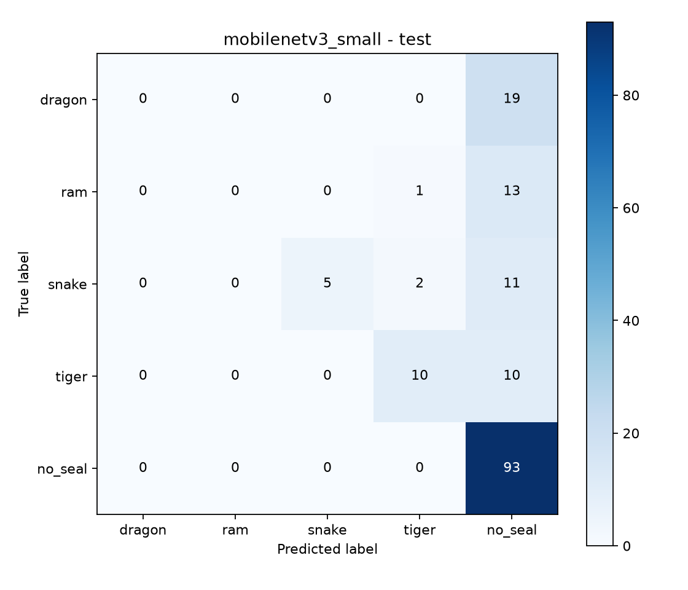

# Collected-data retraining — 2026-10-11

The selected shared model is `artifacts/exports/collected_mobilenetv3_v1.torchscript.pt` with its matching metadata. It improves aggregate public-benchmark scores, but remains unreliable across the four target signs: Dragon and Ram have zero recall on the reused test set.

| Metric | Previous shared model | Retrained model |
|---|---:|---:|
| Validation macro F1 | 0.3733 | 0.4721 |
| Test macro F1 | 0.3151 | 0.3638 |
| Test balanced accuracy | 30.49% | 35.56% |
| Test accuracy | 62.20% | 65.85% |
| Actual signs correctly classified | 10/71 | 15/71 |

Selection used validation macro F1: epoch 7 won, and early stopping ended training after epoch 14. The previous artifact was freshly evaluated on the same 169 validation images. The 164 public test images were evaluated once after selection for this retraining; this benchmark was used in earlier work, so it is not a new blind test. Most correct predictions remain `no_seal`. Per-class test recall: Dragon 0/19, Ram 0/14, Snake 5/18, Tiger 10/20, no_seal 93/93.



## New source audit and preparation

Source revision: `0b237e5` (Add collected HandSeal dataset). Git LFS fsck passed for all 4,063 committed photos. Metadata has 4,098 rows; 35 entries refer to photos absent from the commit. Available files passed decoding, dimensions, and checksum checks.

The supplied collected splits failed the original strict audit: two transitive average-hash similarity groups span train/valid/test (sizes 2,188 and 497). This coarse hash can also group similar poses/backgrounds; these flags do not prove copied frames. The meaning of participant IDs P01/P04/P05 could not be confirmed. Accordingly, the uploaded files and metadata were preserved, and their validation/test splits were excluded from this benchmark.

Only collected **training** photos were added to the prepared public v3 training split. One exact duplicate and 35 images linked to public held-out similarity groups were excluded, leaving 1,023 additions. The combined dataset has 2,608 images: 2,275 train, 169 validation, 164 test. Public validation/test files were verified byte-identical.

The combined copy passed the exploratory audit: zero corrupt images, metadata mismatches, or detected cross-split exact/near/source/known-participant/session leakage. Existing public capture metadata is incomplete, and strict person-disjoint generalization is not established. Preparation summary and fingerprint are in `collected_data_preparation.json`; full local audits remain under `local_setup/collected_retrain/` and the prepared dataset directory.

## Reproduction

Prepare the public v3 base following `EXTERNAL_BASELINE.md` and `IMPROVEMENTS.md`, then download the collected source with Git LFS:

```powershell
git lfs pull
python -m scripts.prepare_collected_training --base handseal_dataset_external_v3 --source handseal_collected --output handseal_dataset_external_collected_v1
python -m training.train --config training/configs/collected_retrain.yaml --run-name collected_mobilenetv3_v1 --device cuda
python -m training.export --checkpoint artifacts/collected_mobilenetv3_v1/best.pt --output-dir artifacts/exports
```

Use fresh run/output names for additional experiments. The preparation script refuses to overwrite an existing output. Training used ImageNet-pretrained MobileNetV3-Small, seed 42, 224-pixel inputs, AdamW learning rate 0.0003, class-weighted loss, ordinary shuffled sampling, and the existing modest augmentation. Model selection and export do not require the source collected validation/test splits.

## Artifact verification

The 6,525,476-byte export loaded through the real app predictor after moving its pair of files to a separate folder. Its five output logits were finite and exactly matched the checkpoint on a real public held-out image (maximum difference 0.0). This verifies export compatibility; real-camera accuracy has not been measured. Model SHA-256: `66bbfbba9381901cecad4b9c72c3ab82f6159040c030e84fd944f39c9ae94335`.

All 41 unit tests passed. An independent review found no important leakage or preservation issue in the prepared data. The previous shared model remains in Git for comparison. New weights and matching portable metadata are included in ordinary Git; checkpoints and derived datasets remain local.
