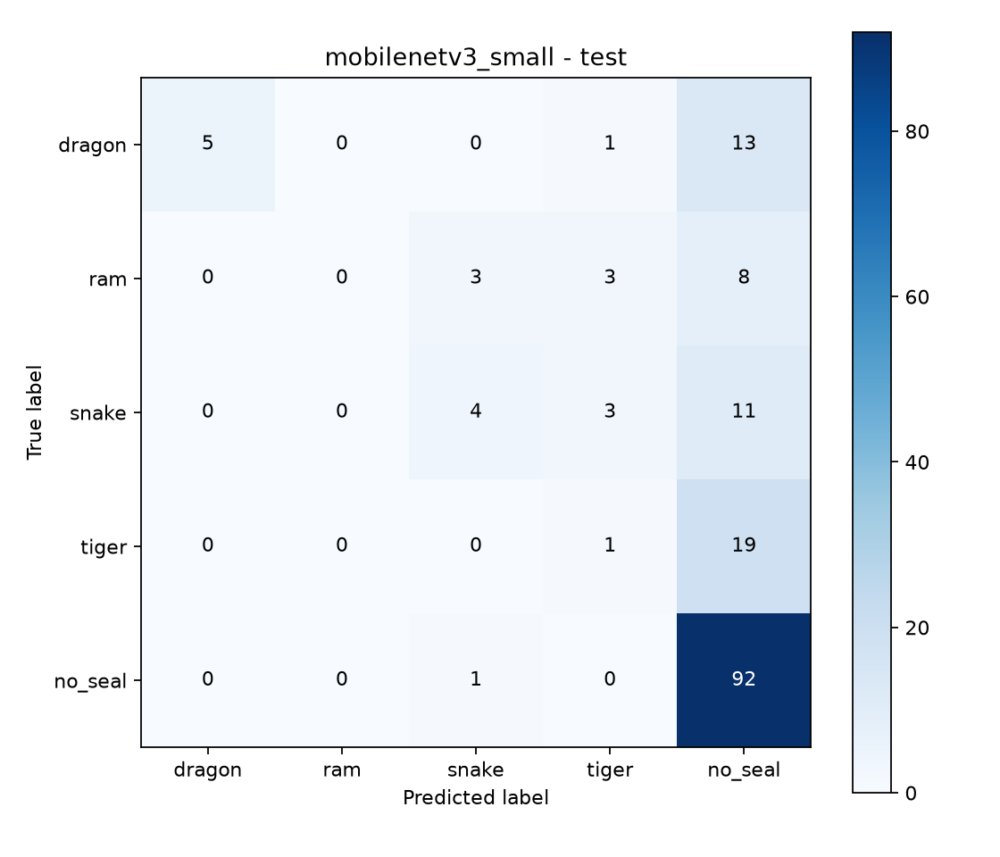

# Training results — 2026-10-11

The public-data baseline has been trained, evaluated, exported, and verified through the app's actual model loader on an RTX 3060. It is not reliable for real sign recognition yet: test macro-F1 is 0.315, balanced accuracy is 30.5%, and ordinary accuracy is 62.2%. Most correct predictions are no_seal. Only 10 of the 71 actual sign images are classified correctly, and none of the 14 Ram examples are recognized.

## Validation selection

Two runs used the same 1,185-image prepared dataset and seed 42. The held-out test was evaluated once, after selection; it was not used to choose parameters.

| Run | Learning rate | Epochs completed | Selected epoch | Best validation macro-F1 |
|---|---:|---:|---:|---:|
| external_mobilenetv3_v1 | 0.0003 | 8 | 1 | 0.373 |
| external_mobilenetv3_low_lr_v1 | 0.00003 | 10 | 3 | 0.349 |

The first run was selected. Both runs used ImageNet MobileNetV3-Small, class-weighted loss, and early stopping. Training loss fell while validation scores declined, which is evidence of overfitting on these source images.

## Test results

| Class | Test images | Recall | F1 |
|---|---:|---:|---:|
| dragon | 19 | 0.263 | 0.417 |
| ram | 14 | 0.000 | 0.000 |
| snake | 18 | 0.222 | 0.308 |
| tiger | 20 | 0.050 | 0.071 |
| no_seal | 93 | 0.989 | 0.780 |

## Data audit and limitations

The prepared dataset has 852 train, 169 validation, and 164 test images. All five labels are present in each split. The audited outputs have zero unreadable images, metadata value mismatches, and detected cross-split source, exact duplicate, near-duplicate, known participant, or known session groups. Sixteen selected HaGRID samples were excluded to preserve native split assignments.

Capture metadata remains incomplete for all 1,185 images, so the original participant-strict audit still rejects this dataset. HaGRID subject IDs are real and its known subjects remain separated; Naruto IDs are unknown. This is not evidence of person-disjoint Naruto generalization. Average-hash grouping is conservative and is not proof that every possible visual near-duplicate or unknown subject has been detected.

Naruto images and HaGRID negatives have different source appearances. Natural-hand negative crops do not cover all empty backgrounds and sign transitions. No webcam quality or latency measurement has been made. Kaggle lists the Naruto source license as Unknown; HaGRID's actual custom license and attribution are retained locally. Data preparation details and repeat commands are in [EXTERNAL_BASELINE.md](EXTERNAL_BASELINE.md).

## Artifacts on this PC

- Selected checkpoint: artifacts/external_mobilenetv3_v1/best.pt
- Exported model: artifacts/exports/external_mobilenetv3_v1.torchscript.pt (6,524,367 bytes)
- App metadata: artifacts/exports/external_mobilenetv3_v1.metadata.json
- Full source manifests, audits, configurations, and epoch histories remain in the local dataset and artifact directories, which are ignored by Git.

Export logits matched the selected checkpoint exactly in the integration check. The app loader and finite five-class output checks passed. The metadata uses a relative model filename so the model/metadata pair can be moved together. All 34 unit tests passed; the dataset/audit changes received independent code review with no remaining actionable findings.

Aggregate metrics and histories are saved in [results.json](results.json). Source archive CRC checks passed and SHA-256 fingerprints are recorded in [source_archives.json](source_archives.json). Dataset fingerprint: `dadd10b0a7640c0c717811ba7c2f366514be195b9093e56a7077fcd8ca25bed2`.

The next useful improvement is independent Naruto sign data spanning more people and conditions, plus broader negative examples. Additional tuning should use validation or a new evaluation split, since this test result is now known.
